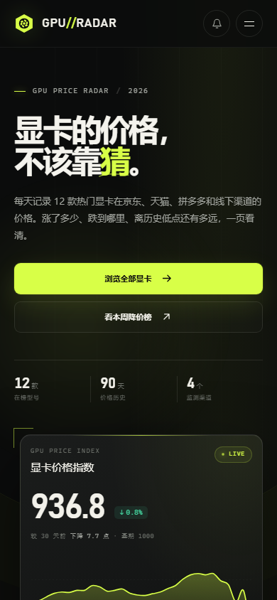

# GPU//RADAR — 显卡价格雷达

一个以「价格变化」为核心的显卡行情网站。深色工业风界面，把 12 款热门显卡的每日价格、历史低点、渠道价差和 90 天走势放在同一页里。




## 预览

直接双击 `index.html` 即可，无需安装任何依赖或执行构建。

也可以在当前目录启一个本地服务器：

```powershell
python -m http.server 8123
```

然后访问 `http://127.0.0.1:8123/`。

## 功能

- **显卡价格指数**：根据 12 款显卡的 90 天价格生成，展示 30 天涨跌和中位价。
- **实时价格条**：顶部滚动展示各型号当前价与当日涨跌。
- **筛选与排序**：按品牌、价位、搜索词筛选，支持价格、近 30 天降幅、性能、历史低点排序，以及「只看今日降价」。
- **价格曲线**：每张显卡都有 30 天迷你走势；详情抽屉支持 7 / 30 / 90 天切换和鼠标悬停读数。
- **渠道报价**：京东、天猫、拼多多、线下渠道的模拟报价与库存状态。
- **价格变动事件**：自动提取近 90 天幅度较大的调价记录。
- **价格提醒**：在详情里设置心理价位，保存在浏览器本地；顶部可查看全部提醒。
- **显卡对比**：最多选择 3 款，横向比较价格、涨跌、显存、功耗、性能指数和每千元性能。
- **深链**：详情页支持 `#gpu=rtx-5080` 形式的地址，方便直接分享某个型号。
- **响应式**：桌面三列、平板两列、手机单列；支持触屏与键盘操作。

## 文件

```
index.html          页面结构
assets/styles.css   视觉样式与响应式布局
assets/data.js      可复现的 90 天模拟行情数据
assets/app.js       渲染、图表、筛选、详情、对比、提醒
```

## 数据说明

这是前端演示项目。页面内所有价格、指数、渠道和调价事件均为**模拟数据**（数据日期 2026-11-08），不构成任何购买建议。价格提醒只保存在当前浏览器的 `localStorage` 中，不会发送真实通知。
